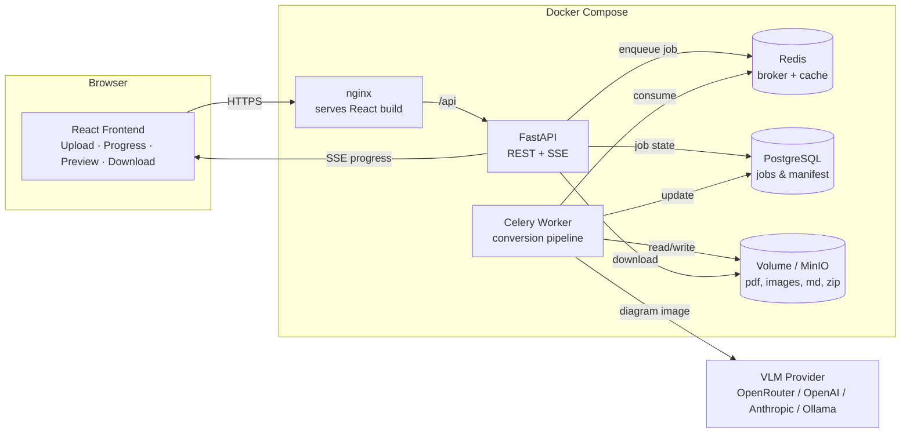

# PDF eBook → Chapter-wise Markdown Converter — Architecture Plan

**Status:** APPROVED 2026-10-09 — Phases 0–4 implemented and locally verified; Phase 5 next
**Date:** 2026-10-09

**Locked decisions (user, 2026-10-09):**
- Diagram→Mermaid engine: **hybrid** — local Ollama vision model first, configured cloud VLM (OpenRouter, OpenAI, Anthropic) as fallback
- OCR (Tesseract) for scanned/image-only PDFs: **included from day one**
- Storage: **local Docker volumes** (MinIO/S3 compose profile deferred)

---

## 1. Goals & Non-Functional Requirements

| Requirement | Target |
|---|---|
| Convert PDF eBooks into Markdown, split **chapter-wise** | ✅ Core |
| Preserve flowcharts/diagrams as **Mermaid** code blocks | ✅ Core |
| Preserve tables as Markdown tables, images as linked files | ✅ Core |
| Output stored in **chapter folders in correct order** (`01_…`, `02_…`) | ✅ Core |
| Web **frontend** for upload / monitor / download | ✅ Core |
| Fully **Dockerized** (one-command bring-up) | ✅ Core |
| Quality bar | SOLID, design patterns, structured logging, exception handling, tests |

**NFRs:** handle 500-page books, 50 MB uploads (configurable), concurrent jobs, progress feedback, resumable/idempotent jobs, no data loss on worker crash (job state in DB).

---

## 2. Tech Stack (with rationale)

| Layer | Choice | Why |
|---|---|---|
| **Backend API** | **Python 3.12 + FastAPI** | Best PDF/ML ecosystem; async; auto OpenAPI docs; easy DI for SOLID |
| **Worker** | **Celery + Redis** (broker & result backend) | Mature, retries, task routing, horizontal scaling |
| **PDF parsing** | **PyMuPDF (fitz)** primary, **pdfplumber** secondary | PyMuPDF: fast, fonts/spans/blocks/images/TOC. pdfplumber: superior table extraction |
| **OCR (scanned pages)** | **Tesseract** (+ optional PaddleOCR) | Fallback when a page has no text layer |
| **Diagram → Mermaid** | **Pluggable VLM adapter** (OpenRouter / OpenAI / Anthropic / local Ollama vision) | Mermaid-from-image is a vision task; adapter pattern keeps it swappable |
| **Image classification** | Heuristic (size, aspect, color count) + optional CLIP | Decide "diagram vs photo" cheaply before spending VLM calls |
| **Frontend** | **React 18 + TypeScript + Vite + shadcn/ui + Tailwind** | Fast dev, typed, rich component ecosystem |
| **Progress updates** | **SSE (Server-Sent Events)** from FastAPI | Simpler than WebSockets for one-way progress; survives reconnects |
| **Mermaid preview** | **mermaid.js** in frontend | Render diagrams in the preview pane |
| **Database** | **PostgreSQL 16** | Job metadata, chapter manifest, progress, audit |
| **Object storage** | **Local volume by default; MinIO (S3-compatible) optional** | Uploaded PDFs, extracted images, output MD tree, final ZIP |
| **Packaging** | **Docker Compose** (dev) → single `docker compose up` | api, worker, redis, postgres, web (nginx), (minio) |
| **Logging** | **structlog** (JSON, correlation IDs) | Machine-parseable, per-job tracing |
| **Testing** | pytest (unit/integration), Playwright (E2E), contract tests vs OpenAPI | Quality gate before merge |

---

## 3. High-Level Architecture



**Flow:** Upload → validate → enqueue Celery job → worker runs pipeline → progress events to DB → API streams SSE to UI → user previews chapters (Mermaid rendered) → downloads ZIP of ordered chapter folders.

---

## 4. Conversion Pipeline (worker stages)

Each stage is a **separate class with a single responsibility**, orchestrated by a **Pipeline/Orchestrator**:

| # | Stage | Responsibility | Key libs |
|---|---|---|---|
| 1 | `UploadValidator` | MIME/pdf magic check, page count, size limit, optional AV scan | PyMuPDF |
| 2 | `ChapterDetector` | Chapter boundaries: PDF outline/bookmarks first; fallback to font-size/heading heuristics | PyMuPDF TOC + span analysis |
| 3 | `TextExtractor` | Per-chapter text with layout, heading levels, lists, code blocks | PyMuPDF / pdfplumber |
| 4 | `TableExtractor` | Tables → Markdown tables (fallback: plain text grid) | pdfplumber |
| 5 | `ImageExtractor` | Extract embedded images per page, save as files | PyMuPDF |
| 6 | `DiagramClassifier` | Heuristic: diagram vs photo vs screenshot | Pillow stats |
| 7 | `MermaidConverter` | Diagram image → Mermaid code (VLM adapter, retry + circuit breaker) | Adapter → OpenRouter/OpenAI/Anthropic/Ollama |
| 8 | `MarkdownAssembler` | Build chapter `.md` with frontmatter, mermaid blocks, image links | Builder pattern |
| 9 | `ChapterWriter` | Write `NN_Chapter_Name/` folders in order, zero-padded | Filesystem repository |
| 10 | `PackageBuilder` | Zip the output tree for download | zipfile |

**Failure semantics:** a failing stage never corrupts the job — stage errors are logged with correlation ID, the stage is marked `FAILED`/`SKIPPED` (with reason), and the pipeline continues where safe (e.g., a diagram that fails Mermaid conversion is embedded as an image with a `<!-- mermaid conversion failed -->` note).

---

## 5. SOLID Mapping (explicit)

| Principle | Application |
|---|---|
| **S — Single Responsibility** | One class per pipeline stage; API layer only does HTTP; repositories only do storage; no god-classes |
| **O — Open/Closed** | New PDF parser or VLM provider = new class implementing the interface; no edits to orchestrator |
| **L — Liskov Substitution** | `PyMuPDFParser` and `PdfPlumberParser` are interchangeable behind `ITextExtractor`; any `IVLMProvider` can replace another |
| **I — Interface Segregation** | Small interfaces: `ITextExtractor`, `IImageExtractor`, `IDiagramToMermaid`, `IChapterStore`, `IProgressReporter` — clients never depend on methods they don't use |
| **D — Dependency Inversion** | All collaborators injected via constructors; FastAPI `Depends()` at the API boundary; composition root in `app/container.py` |

## 6. Design Patterns

| Pattern | Where |
|---|---|
| **Strategy** | Text extraction (PyMuPDF vs pdfplumber), OCR engine selection |
| **Adapter** | VLM providers (OpenRouter / OpenAI / Anthropic / Ollama) behind `IVLMProvider` |
| **Factory** | Create parser/extractor instances from config (`ParserFactory`) |
| **Repository** | `JobRepository`, `ChapterRepository`, `FileStore` — DB and storage behind interfaces |
| **Observer / Pub-Sub** | Progress events: pipeline → event bus → DB + SSE stream |
| **Orchestrator (Saga-style)** | `ConversionOrchestrator` sequences stages, handles stage failure policy |
| **Builder** | `MarkdownAssembler` builds chapter documents step by step |
| **Retry + Circuit Breaker + Timeout** | `tenacity` around all VLM/network calls |
| **Template Method** | `BasePipelineStage.run()` = skeleton (timing, logging, error capture); subclasses implement `execute()` |

---

## 7. API Design (FastAPI)

| Method | Endpoint | Purpose |
|---|---|---|
| POST | `/api/v1/jobs` | Upload PDF (multipart, chunked for large files) → returns `job_id` |
| GET | `/api/v1/jobs` | List jobs (filter by status) |
| GET | `/api/v1/jobs/{id}` | Job detail: status, per-stage progress, chapter manifest |
| GET | `/api/v1/jobs/{id}/events` | **SSE** stream of progress events |
| GET | `/api/v1/jobs/{id}/chapters` | List generated chapter files |
| GET | `/api/v1/jobs/{id}/chapters/{n}/preview` | Raw Markdown of chapter `n` (for preview pane) |
| GET | `/api/v1/jobs/{id}/download` | ZIP of the ordered chapter tree |
| DELETE | `/api/v1/jobs/{id}` | Delete job + artifacts |
| GET | `/healthz`, `/readyz` | Docker healthchecks |

---

## 8. Frontend Design (React + TS)

- **Pages:** `Dashboard` (job list) · `Upload` (drag-drop, chunked, validation) · `JobDetail` (live progress via SSE, stage status, chapter list) · `Preview` (Markdown + **Mermaid rendering** + image gallery per chapter)
- **State:** React Query (server state) + Zustand (UI state)
- **Components (shadcn/ui):** Dropzone, Progress, DataTable, Tabs, Toast (Sonner)
- **API client:** typed, generated from FastAPI OpenAPI (openapi-typescript-codegen)
- Served by **nginx** in Docker, proxying `/api` → FastAPI

---

## 9. Docker Compose Topology

| Service | Image | Notes |
|---|---|---|
| `web` | nginx + built React bundle | Port 80 (mapped), proxies `/api` |
| `api` | Python 3.12, FastAPI/uvicorn | Port 8000 internal |
| `worker` | Same image as api, `celery -A app.worker worker` | Scales with `--scale worker=N` |
| `redis` | redis:7-alpine | Broker + result backend + progress cache |
| `db` | postgres:16-alpine | Jobs, chapters, stage status |
| `minio` *(optional profile)* | minio + console | S3-compatible storage for prod |
| `tesseract` | Tesseract OCR baked into api/worker image | `Dockerfile` apt-installs it |

Volumes: `uploads`, `outputs`, `db_data`, `redis_data`. `.env.example` for all config. `docker compose up --build` = entire app running.

---

## 10. Exception Handling & Logging

- **Exception hierarchy:** `AppError` → `ValidationError`, `ProcessingError`, `StageError`, `ProviderError` (VLM), `StorageError`; each with `error_code`, HTTP mapping, and safe user message (no internals leaked)
- **Global handlers:** FastAPI `exception_handler`s → consistent JSON error envelope `{error_code, message, correlation_id, details}`
- **Stage-level:** `BasePipelineStage` wraps execution in try/except, records `StageResult(status, error, duration)`; orchestrator applies failure policy (skip/continue vs abort)
- **Retries:** `tenacity` (exponential backoff + jitter) on VLM calls, DB transient errors, storage IO; circuit breaker on VLM provider
- **Logging:** `structlog`, JSON to stdout (Docker log driver), levels via env; **correlation ID** (`job_id`) on every log line; per-stage timing metrics
- **Observability (phase 2):** Prometheus metrics + Grafana dashboard

---

## 11. Data Model (PostgreSQL)

- `jobs` — id, filename, status (`QUEUED/RUNNING/SUCCEEDED/FAILED/PARTIAL`), page_count, chapter_count, output_path, error, timestamps
- `job_stages` — job_id, stage_name, status, started_at, finished_at, error, metrics (JSON)
- `chapters` — job_id, order_index, title, folder_name, md_path, mermaid_count, image_count, word_count
- `progress_events` — job_id, ts, stage, percent, message (also fanned out to SSE)

---

## 12. Chapter Detection & Ordering (detail)

1. **Primary:** PDF outline/bookmarks (PyMuPDF `get_toc()`) — respects author-defined chapters
2. **Fallback:** heading heuristics — font size/weight clustering; lines matching `Chapter N`, `N. Title` patterns
3. **Normalization:** sanitize titles → `01_Introduction`, `02_Getting_Started` (zero-padded, filesystem-safe, **order = numeric prefix**)
4. **Manifest:** `chapters.json` in output root records order, titles, source page ranges

---

## 13. Diagram → Mermaid (detail)

1. Extract images per page with bounding boxes (PyMuPDF `page.get_images` + placement)
2. **Classify** (heuristic): few colors + large uniform regions + sharp edges → likely diagram; else photo
3. For likely diagrams → `IVLMProvider.diagram_to_mermaid(image)` with a strict prompt ("output ONLY a mermaid code block, diagram type: flowchart/sequence/class/er/…")
4. **Validate** the Mermaid (parse check via `mermaid.parse` in frontend; backend: regex sanity + non-empty); on failure → keep original image + note, mark stage `PARTIAL`
5. Emit into chapter MD as ```` ```mermaid ```` block at the correct position in the text flow (image bbox → nearest paragraph anchor)

---

## 14. Security

- Upload: extension + magic-byte check, size/page caps, filename sanitization, **path traversal protection** in all file writes
- Optional ClamAV sidecar for AV scanning (compose profile)
- No eval of model output; Mermaid rendered in sandboxed frontend
- Secrets only via env; `.env` gitignored; non-root containers; read-only root FS where feasible
- Rate limiting on upload endpoint (`slowapi`)

---

## 15. Testing Strategy

- **Unit:** every pipeline stage with fixture PDFs (text-only, with TOC, scanned/OCR, with diagrams, with tables)
- **Integration:** API + worker + redis + postgres via `docker compose -f docker-compose.test.yml`
- **Contract:** frontend client generated from OpenAPI; schema drift fails CI
- **E2E:** Playwright — upload → wait SSE → preview chapter → download ZIP → assert folder order
- **Fixtures:** small synthetic PDFs generated with reportlab (kept in `tests/fixtures/`)

---

## 16. Project Structure

```
pdf2md-converter/
├── ARCHITECTURE_PLAN.md          ← this document
├── docker-compose.yml
├── docker-compose.test.yml
├── .env.example
├── backend/
│   ├── Dockerfile
│   ├── pyproject.toml            (ruff, mypy, pytest config)
│   └── app/
│       ├── main.py               (FastAPI app, routers, exception handlers)
│       ├── config.py             (pydantic-settings)
│       ├── container.py          (composition root / DI)
│       ├── api/v1/               (jobs, chapters, events routers)
│       ├── domain/               (entities, enums, exceptions)
│       ├── services/             (orchestrator, stages/, pipeline/)
│       ├── adapters/             (vlm/ providers, storage/, parsers/)
│       ├── repositories/         (job, chapter, progress)
│       ├── worker/               (celery app + task)
│       └── logging.py            (structlog setup)
├── frontend/
│   ├── Dockerfile  (nginx)
│   ├── package.json
│   └── src/ (pages, components, api client, hooks)
└── tests/
    ├── unit/  integration/  e2e/  fixtures/
```

---

## 17. Implementation Phases

| Phase | Deliverable | Status |
|---|---|---|
| **0** | Repo skeleton, docker-compose, CI lint/type/test, healthchecks | ✅ done |
| **1** | Backend: upload API, job model, Celery plumbing, SSE progress (stub pipeline) | ✅ done |
| **2** | Pipeline stages 1–5, 8–10 (text, OCR, tables, images, assembly, ordered folders, ZIP) — **works end-to-end without Mermaid** | ✅ done |
| **3** | Stage 6–7: embedded raster diagram classification + VLM Mermaid adapter (Ollama → OpenRouter → OpenAI → Anthropic, image fallback); vector-only diagrams deferred | ✅ done |
| **4** | React frontend: upload, live SSE progress + polling, chapter list, Markdown/Mermaid/image preview, ZIP download, job management | ✅ done |
| **5** | Hardening: security, rate limits, migrations, metrics, optional MinIO profile | ⬜ next |

**Phase 0–4 + runtime settings verification (2026-10-09):** Backend `ruff check`, `ruff format --check`,
`mypy` (76 source files) ✅ · `pytest` (96 passed, including admin/settings and diagram-review API/ZIP integration) ✅.
Frontend `npm run typecheck`, `npm run test` (30 tests, including review actions/preview refresh), `npm run build` ✅.
The admin-only settings page persists encrypted vision keys and conversion limits in PostgreSQL; API and worker load them for new jobs. First-run setup uses a short-lived code from the API container CLI. API/worker require a shared `settings_keys` volume. Full Compose bring-up and live Ollama/cloud conversion still require a Docker host/model.

---

## 18. Open Decisions (need your call)

1. **Diagram → Mermaid engine:** (a) cloud VLM (best accuracy, needs API key, per-image cost), (b) local Ollama vision model (private, free, needs GPU/strong CPU), (c) **hybrid** — local first, cloud fallback (recommended default)
2. **OCR:** include Tesseract for scanned pages from day one, or phase 2?
3. **Storage:** local Docker volumes only, or also provide the MinIO/S3 profile now?

Once you approve the plan (and answer the 3 decisions), I'll start with **Phase 0 + 1** and proceed phase by phase.
